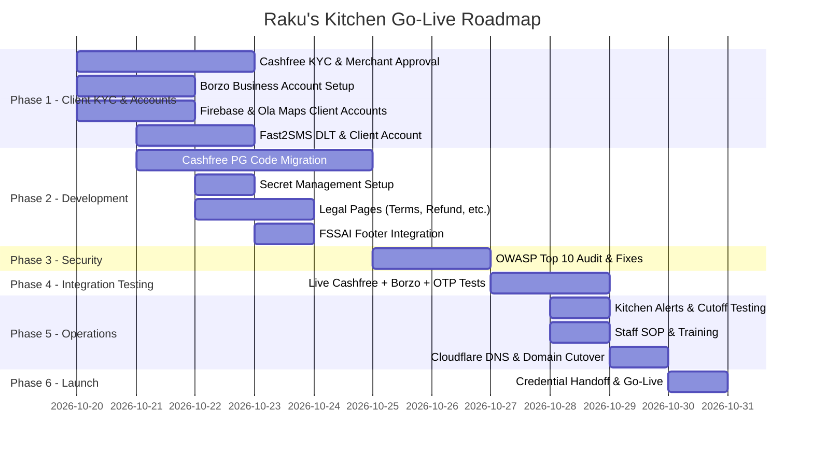

# Raku's Kitchen — Go-Live Delivery Plan

**Project:** Direct-to-Consumer Food Ordering Platform & Kitchen Dispatch Engine  
**Client:** Raku's Kitchen (Bengaluru)  
**Service Provider:** Nexus Development  
**Date:** October 2026  

---

## Hosting Architecture (Locked In)

### Firebase App Hosting + Cloudflare CDN (₹0/month)

```
Customer's Phone / Browser
        │
        ▼
┌───────────────────┐
│   Cloudflare      │  ← DNS, SSL, DDoS Protection, Edge CDN Cache
│   (Free Tier)     │     Caches static assets (images, CSS, JS)
│   ₹0/month        │     Unlimited bandwidth
└────────┬──────────┘
         │
         ▼
┌───────────────────┐
│  Firebase App     │  ← Runs ENTIRE Next.js 14 app
│  Hosting (Blaze)  │     (Frontend + API Routes + Server Actions)
│  ₹0/month*        │     * Within free quotas at 100 orders/day
└────────┬──────────┘
         │
         ▼
┌───────────────────┐
│  Cloud Firestore  │  ← Database + Auth (Client's own account)
│  (Blaze Free Tier)│
│  ₹0/month*        │
└───────────────────┘
```

### Why This Architecture

| Concern | Answer |
| :--- | :--- |
| **Commercial use?** | ✅ Fully allowed on Firebase Blaze |
| **Deploy limits?** | ✅ No hard cap (~625 builds/month within free Cloud Build quota) |
| **100 orders/day capacity?** | ✅ Uses <10% of all free quotas |
| **Monthly cost?** | ✅ ₹0 (Blaze = pay-as-you-go with free tier included) |
| **`firebase-admin` compatibility?** | ✅ Native — no edge runtime polyfills needed |
| **DDoS & security?** | ✅ Cloudflare enterprise-grade WAF + DDoS (free) |
| **Outgoing bandwidth?** | ✅ Cloudflare serves 90%+ of static content; Firebase sees ~1–2 GB/month |

### Free Quota Headroom (Monthly)

| Resource | Free Quota | Rakus Kitchen Usage | Utilization |
| :--- | :--- | :--- | :--- |
| Cloud Build Minutes | 2,500 min | ~150 min (40 deploys × ~4 min) | **6%** |
| Cloud Run Requests | 2,000,000 | ~30,000 | **1.5%** |
| Cloud Run Compute | 180,000 vCPU-sec | ~5,000 | **3%** |
| Firestore Reads | 50,000 / day | ~3,000 / day | **6%** |
| Firestore Writes | 20,000 / day | ~500 / day | **2.5%** |
| Outgoing Bandwidth | 10 GB | ~1–2 GB (with Cloudflare CDN) | **15%** |

---

## Delivery Checklist

### Phase 1: Client KYC & Third-Party Account Setup (Days 1–3)

#### 1.1 Cashfree Payment Gateway — Client Documents Required

> [!IMPORTANT]
> Cashfree will NOT activate the live account unless the website has visible legal pages (Refund Policy, Terms, Privacy, Shipping Policy, Contact Us) in the footer.

**If Sole Proprietorship / Individual:**

- [ ] PAN Card of the Proprietor
- [ ] Aadhaar Card (front & back) with linked mobile for DigiLocker OTP
- [ ] Business Address Proof (any one):
  - GST Certificate (if registered), OR
  - Shop & Establishment Certificate / Trade License, OR
  - FSSAI Registration Certificate
- [ ] Bank Account Details for Payouts:
  - Cancelled Cheque (with proprietor name printed), OR
  - Bank Statement (last 3 months) with bank seal
- [ ] Live Website URL with:
  - Contact information
  - Terms & Conditions page
  - Cancellation / Refund Policy page
  - Shipping / Delivery Policy page

**If Partnership / Pvt Ltd / LLP:**

- [ ] Company PAN Card & Certificate of Incorporation / Partnership Deed
- [ ] GST Certificate
- [ ] FSSAI License
- [ ] Authorized Signatory's PAN & Aadhaar
- [ ] Cancelled Cheque of company current account
- [ ] Board Resolution / Authorization Letter (for Pvt Ltd)

**Activation Timeline:** 24–48 hours after document submission.

---

#### 1.2 Borzo Delivery — Client Account Switch

**Documents & Setup Required:**

- [ ] Registered Mobile Number & Email (official kitchen phone, not personal)
- [ ] GSTIN Certificate (required for postpaid corporate contract)
- [ ] Kitchen Pickup Address with:
  - Exact latitude/longitude
  - Floor/unit number & landmark
  - Kitchen manager name & contact number
- [ ] Initial Wallet Recharge: Min ₹500–₹1,000

**Migration Steps:**

- [ ] Create Borzo Business account under client's credentials
- [ ] Generate Production API Token from client's dashboard
- [ ] Update `BORZO_API_KEY` and `BORZO_API_BASE` in Firebase App Hosting environment variables
- [ ] Remove your personal Borzo account credentials from all environments

---

#### 1.3 Firebase & Google Cloud — Client Account Setup

- [x] Create dedicated Google Account (`rakuskitchen369@gmail.com`)
- [x] Create Firebase project under client's account (`rakus-kitchen-prod`)
- [x] Enable Blaze (pay-as-you-go) plan — link client's debit/credit card
- [ ] **Set budget alert at ₹100/month** (Google Cloud Console → Billing → Budgets)
- [x] Enable Cloud Firestore (production mode, Native database in Mumbai)
- [x] Enable Firebase Authentication (Email/Password & Authorized domains configured)
- [ ] Enable Firebase App Hosting
- [x] Generate Service Account key for `firebase-admin` (configured in .env.production)
- [ ] Invite your developer account as Editor during setup phase
- [x] Migrate Firestore Security Rules from dev project (deployed via CLI)
- [x] Initialize Firestore Admin access & structure (verified via Admin SDK)

---

#### 1.4 Ola Maps — Client Account Setup

- [x] Register at Ola Maps Developer Console using client's business email (`rakuskitchen369@gmail.com`)
- [x] Generate Production `API_KEY`
- [x] Configure for backend server-to-server API calls (no restrictive browser domain blocks)
- [x] Update `OLA_MAPS_API_KEY` in production environment (`.env.production`) and verify live live geocoding & autocomplete

---

#### 1.5 Fast2SMS — Client Account Setup

- [ ] Create Fast2SMS account under client's credentials
- [ ] Complete DLT Registration (TRAI mandatory for commercial SMS)
- [ ] Configure Quick OTP Route with approved sender ID
- [ ] Test OTP delivery to DND numbers (must arrive within 5–10 seconds)
- [ ] Initial wallet recharge: Min ₹500
- [ ] Update `FAST2SMS_API_KEY` in Firebase App Hosting environment variables

---

### Phase 2: Development & Migration (Days 2–5)

#### 2.1 Cashfree Payment Gateway Code Migration

- [ ] Replace `razorpay` npm package with `cashfree-pg` SDK
- [ ] Update `src/app/api/payments/create-order/route.ts` for Cashfree session creation
- [ ] Implement Cashfree Webhook signature verification (using raw body + client secret)
- [ ] Update checkout UI to load Cashfree JS SDK instead of Razorpay checkout modal
- [ ] Test ₹1 live transaction end-to-end
- [ ] Remove old Razorpay credentials from all environments

#### 2.2 Secret Management — Firebase App Hosting Environment Variables

- [x] Verify `.env.local`, `.env`, `.env.production`, and all `.json` service account files are in `.gitignore`
- [x] Create `.env.example` with variable names only (no real values)
- [x] Map public and secret environment variables in `apphosting.yaml`
- [ ] Configure all secrets in Firebase App Hosting dashboard / Cloud Secret Manager (encrypted at rest):
  - `CASHFREE_APP_ID`
  - `CASHFREE_SECRET_KEY`
  - `CASHFREE_WEBHOOK_SECRET`
  - `BORZO_API_KEY`
  - `FAST2SMS_API_KEY`
  - `FAST2SMS_SECRET_SALT`
  - `OLA_MAPS_API_KEY`
  - `FIREBASE_ADMIN_PROJECT_ID`
  - `FIREBASE_ADMIN_CLIENT_EMAIL`
  - `FIREBASE_ADMIN_PRIVATE_KEY`
  - `NEXT_PUBLIC_FIREBASE_API_KEY`
  - `NEXT_PUBLIC_FIREBASE_AUTH_DOMAIN`
  - `NEXT_PUBLIC_FIREBASE_PROJECT_ID`
  - `NEXT_PUBLIC_FIREBASE_STORAGE_BUCKET`
  - `NEXT_PUBLIC_FIREBASE_MESSAGING_SENDER_ID`
  - `NEXT_PUBLIC_FIREBASE_APP_ID`

#### 2.3 Mandatory Legal Pages (Cashfree Activation Blocker)

- [x] **Terms & Conditions** page (`/terms`)
- [x] **Privacy Policy** page (`/privacy`) — DPDP compliant
- [x] **Refund & Cancellation Policy** page (`/refund-policy`)
  - "No cancellation once food preparation begins"
  - "Refunds processed within 5–7 business days for payment failures"
- [x] **Shipping & Delivery Policy** page (`/delivery-policy`)
  - Estimated delivery time: 30–45 minutes
  - Delivery radius: e.g. 7 km from kitchen
  - Delivery partner: Borzo / Porter
- [x] **Contact Us** page (`/contact`)
  - Physical kitchen address
  - Phone number & email
  - FSSAI License Number

#### 2.4 FSSAI License Display

- [x] Add 14-digit FSSAI License Number in website footer (legally mandatory for online food ordering in India)
- [ ] Display on checkout confirmation / order receipt

---

### Phase 3: Security Testing — OWASP Top 10 & Pentest (Days 5–7)

#### 3.1 Broken Access Control (OWASP #1)
- [ ] Verify `/admin` routes reject unauthenticated requests
- [ ] Verify `/admin` routes reject non-admin user accounts
- [ ] Test Firestore Security Rules: Customer A cannot read/modify Customer B's orders
- [ ] Test: Changing `orderId` in request URL does not leak other customers' data

#### 3.2 Cryptographic Failures (OWASP #2)
- [ ] Verify Cashfree Webhook Signature validation (raw body + secret)
- [ ] Verify all API routes use HTTPS only
- [ ] Verify Firebase Admin private key is never exposed in client bundle

#### 3.3 Injection (OWASP #3)
- [ ] Sanitize customer name, address, and order notes inputs
- [ ] Test XSS payloads in address fields — must not render in admin dashboard
- [ ] Test SQL/NoSQL injection in Firestore queries (should be safe by design, but verify)

#### 3.4 Insecure Design — Price Tampering (OWASP #4)
- [ ] Verify order total is calculated **server-side** before creating Cashfree session
- [ ] Test: Modifying `amount` in browser DevTools does NOT change the actual charge
- [ ] Verify packaging fee (₹20/unit) is enforced server-side

#### 3.5 Security Misconfiguration (OWASP #5)
- [ ] Check HTTP security headers:
  - `X-Frame-Options: DENY`
  - `Content-Security-Policy`
  - `Strict-Transport-Security`
  - `X-Content-Type-Options: nosniff`
- [ ] Verify `.env` files not in git history (`git log --all --full-history -- "*.env*"`)
- [ ] Verify `server-only` guard on all sensitive server modules
- [ ] Verify `NEXT_PUBLIC_` prefix is NOT used on any secret key

#### 3.6 Vulnerable Components (OWASP #6)
- [ ] Run `npm audit` — fix all critical and high severity vulnerabilities
- [ ] Verify all dependencies are on latest stable versions

#### 3.7 Authentication Failures (OWASP #7)
- [ ] Test OTP brute-force protection (rate limiting on `/api/auth/send-otp`)
- [ ] Verify OTP expiry (should expire after 5–10 minutes)
- [ ] Test: Reusing an old OTP must fail

#### 3.8 Data Integrity (OWASP #8)
- [ ] Verify Cashfree webhook cannot be spoofed with a fake `payment.success` event
- [ ] Test: Replaying a valid webhook payload must not create duplicate orders

#### 3.9 Security Logging (OWASP #9)
- [ ] Verify failed auth attempts are logged
- [ ] Verify payment failures are logged with order ID and error reason

#### 3.10 Server-Side Request Forgery — SSRF (OWASP #10)
- [ ] Verify Ola Maps geocoding input is validated (no arbitrary URL injection)
- [ ] Verify Borzo API calls use hardcoded base URL, not user-supplied endpoints

---

### Phase 4: Live Integration Testing (Days 7–8)

#### 4.1 Cashfree End-to-End Payment Test
- [ ] Create a ₹1 test order through the full checkout flow
- [ ] Verify webhook fires and order status updates in Firestore
- [ ] Verify refund flow works from Cashfree dashboard
- [ ] Test payment failure scenario (insufficient balance / declined card)

#### 4.2 Borzo Live Delivery Test
- [ ] Place a real order to an address 1–2 km from kitchen
- [ ] Verify full lifecycle:
  - Order Created → Courier Assigned → Tracking Link Generated → Pickup at Kitchen → Delivered
- [ ] Test cancellation flow (cancel before driver pickup)
- [ ] Verify delivery cost estimate accuracy

#### 4.3 Fast2SMS OTP Test
- [ ] Send OTP to 3–5 different phone numbers (including DND-enabled numbers)
- [ ] Verify delivery within 5–10 seconds
- [ ] Verify OTP content matches approved DLT template

#### 4.4 Ola Maps Geocoding Test
- [ ] Test 5–10 real Bengaluru addresses within delivery radius
- [ ] Test an out-of-radius address — verify rejection message
- [ ] Verify lat/long accuracy on map

---

### Phase 5: Operational Readiness (Days 8–9)

#### 5.1 Kitchen Alert System
- [ ] Implement audible sound chime (repeating beep) on new order in Admin Dashboard
- [ ] Fallback: WhatsApp/SMS notification to owner's phone on new order
- [ ] Test: Sound plays even when admin tab is in background

#### 5.2 Cutoff Time Verification
- [ ] Test Lunch slot cutoff at 12:30 PM — checkout must block or bump to Dinner
- [ ] Test Dinner slot cutoff at 7:30 PM — checkout must block or bump to next day Lunch
- [ ] Test holiday schedule — verify orders blocked on configured holidays

#### 5.3 Kitchen Staff Training SOP
- [ ] Prepare 1-page visual guide:
  - How to open `/admin` on tablet/phone
  - "Accept Order" → "Ready for Pickup" → "Dispatch via Borzo" flow
  - How to mark an item as "Sold Out"
  - How to check daily order summary
- [ ] Conduct 30-minute live training session with kitchen staff

#### 5.4 Cloudflare DNS & Domain Setup
- [ ] Point client's custom domain nameservers to Cloudflare
- [ ] Configure DNS records pointing to Firebase App Hosting
- [ ] Enable Cloudflare SSL (Full Strict mode)
- [ ] Enable "Always Use HTTPS" redirect
- [ ] Set up Page Rules for caching static assets (images, fonts)
- [ ] Enable Bot Fight Mode (free)

---

### Phase 6: Launch & Credential Handoff (Day 10)

#### 6.1 Credential Handoff Document
Prepare a clean document with all master account credentials and ownership:

- [ ] Google Account (Firebase, Cloud Console) — email, password, 2FA backup
- [ ] Cloudflare Account — email, password
- [ ] Cashfree Dashboard — login, merchant ID
- [ ] Borzo Business Dashboard — login, API token location
- [ ] Ola Maps Developer Console — login, API key location
- [ ] Fast2SMS Dashboard — login, wallet balance, DLT status
- [ ] Domain Registrar — login, domain expiry date, auto-renewal status
- [ ] GitHub Repository — access granted to client (read-only or full)

#### 6.2 Budget Alert & Safety Net
- [ ] Google Cloud Budget Alert set at ₹100/month
- [ ] Cashfree daily settlement limit configured
- [ ] Fast2SMS low-balance alert enabled (notify at ₹100 remaining)

#### 6.3 Go-Live Checklist
- [ ] All environment variables configured in Firebase App Hosting (production)
- [ ] DNS propagation complete (check via `dig` or `nslookup`)
- [ ] SSL certificate active and valid
- [ ] Place 1 real order through the full flow (order → pay → dispatch → deliver)
- [ ] Verify admin dashboard shows the order in real-time
- [ ] Verify WhatsApp notification link works
- [ ] **GO LIVE** 🚀

---

## Timeline Summary



**Estimated Delivery: ~10 working days from contract signing.**
