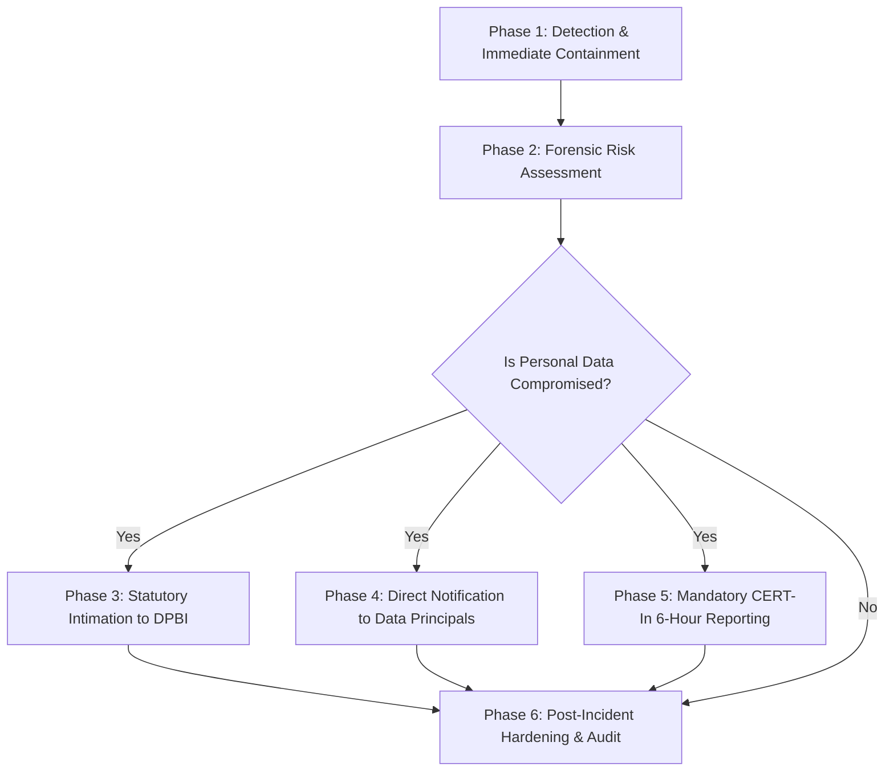

# 🚨 Personal Data Breach Incident Response Protocol
**Governing Regulation:** Section 8(6) of The Digital Personal Data Protection Act, 2023 & Rule 8 of DPDP Rules, 2025  
**Additional Framework:** CERT-In Cyber Security Directions (6-Hour Incident Notification Rule)  
**Organization:** Raku's Kitchen  
**Designated Authority:** Data Protection & Grievance Officer (`grievance@rakuskitchen.in`)

---

## 1. Statutory Definition
Under Section 2(u) of the DPDP Act, 2023:
> *"Personal data breach means any unauthorized processing of personal data or accidental disclosure, acquisition, sharing, use, alteration, destruction of or loss of access to personal data, that compromises the confidentiality, integrity or availability of personal data."*

---

## 2. Six-Phase Incident Response Workflow

### Phase 1: Detection & Immediate Containment (Hour 0 – 1)
1. **Isolate Compromised Channels:**
   - If Firebase API / Admin keys leak: rotate `FIREBASE_ADMIN_PRIVATE_KEY` and client credentials immediately in Google Cloud Console.
   - If Razorpay webhook secret leaks: rotate `RAZORPAY_WEBHOOK_SECRET` in Razorpay Merchant Dashboard.
2. **Preserve System Logs:**
   - Export `/auditLogs` snapshot and server console logs to prevent evidence tampering.

### Phase 2: Forensic Risk Assessment (Hour 1 – 3)
1. Categorize impacted data sets (e.g., customer mobile numbers, delivery addresses, order histories).
2. Quantify the scope of affected Data Principals.
3. Determine whether any unauthorized exfiltration occurred.

### Phase 3: Statutory Intimation to the Data Protection Board of India (DPBI)
Under Section 8(6) of the DPDP Act, 2023, the Data Fiduciary must inform the Board without delay:
- **Intimation Content:**
  - Nature and extent of the personal data breach.
  - Estimated number of affected Data Principals.
  - Potential consequences and risks to Data Principals.
  - Containment and remedial measures undertaken.
  - Contact details of the Data Protection & Grievance Officer.

### Phase 4: Direct Notification to Affected Data Principals
- **Mode of Notice:** SMS / WhatsApp to registered mobile numbers and registered emails.
- **Message Content:**
  - Plain, non-technical description of the breach.
  - What data points were exposed (e.g., address, phone number).
  - Protective actions the Data Principal should take.
  - Helpline / Grievance Officer contact for assistance.

### Phase 5: Mandatory CERT-In Notification (Within 6 Hours)
- Under Cyber Security Directions issued under Section 70B of the IT Act, 2000, cybersecurity incidents must be reported to **CERT-In** (`incident@cert-in.org.in`) within 6 hours of noticing.

### Phase 6: Post-Incident Remediation & Prevention
1. Patch vulnerability and update firestore rules or API middleware.
2. Complete internal incident post-mortem within 7 business days.
3. Retain post-incident audit documentation for minimum 5 years.

---

## 3. Contact Directory for Emergency Escalation
- **Data Protection & Grievance Officer:** Rakesh K. (`grievance@rakuskitchen.in` / `+91 96068 88096`)
- **Engineering / Security Lead:** Nexus Development Support
- **Data Protection Board of India (DPBI):** New Delhi, India
- **CERT-In Incident Desk:** `incident@cert-in.org.in` / Toll Free: `1800-11-4949`
