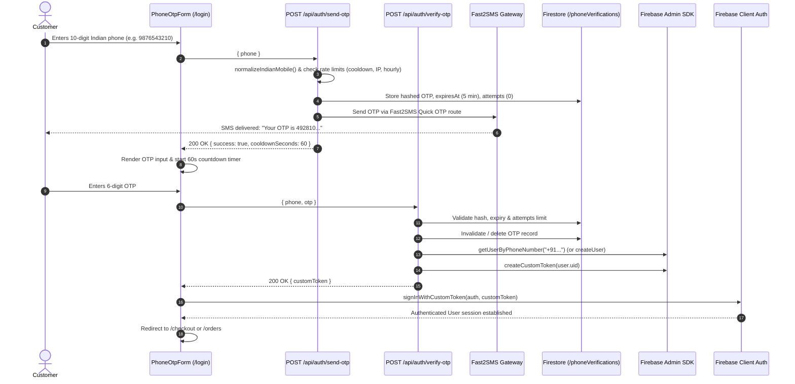
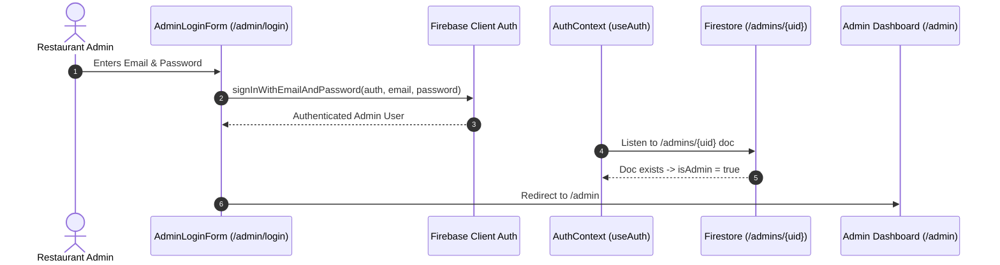

# Raku's Kitchen — Complete Authentication & Authorization Architecture & Migration Plan

## 1. Overview & Architecture Strategy

We are implementing a clear two-tier authentication and authorization architecture:

1. **Customers (Phone OTP via Fast2SMS)**:
   - **Route**: [`/login`](file:///c:/Users/PrajwalVenkatesh/Desktop/Client_Project/rakus-kitchen/src/app/login/page.tsx)
   - **Mechanism**: 10-digit Indian mobile number input → 6-digit OTP dispatched via **Fast2SMS** (`https://www.fast2sms.com/dev/bulkV2`).
   - **Session & Tokens**: Server verifies OTP, retrieves or creates Firebase User, and mints a Firebase Custom Token via `adminAuth().createCustomToken(user.uid)`. Client logs in using `signInWithCustomToken(auth, customToken)`.
   - **Anti-Abuse**: 60-second cooldown, hourly quotas (5/hr/phone), IP throttling, 5-minute TTL, and maximum 5 failed attempts before OTP invalidation.
   - **No reCAPTCHA**: Completely replaces Google's `RecaptchaVerifier` and `signInWithPhoneNumber`.
   - **Authorization**: Customer session has `user.uid` and `user.phoneNumber`. Firestore rules (`resource.data.customerId == request.auth.uid`), [`subscribeMyOrders`](file:///c:/Users/PrajwalVenkatesh/Desktop/Client_Project/rakus-kitchen/src/lib/db.ts#L42-L60), and payment API routes remain 100% intact.

2. **Admins (Email & Password via Firebase)**:
   - **Route**: `/admin/login` (Dedicated, separate from customer login).
   - **Mechanism**: Standard Firebase Email & Password (`signInWithEmailAndPassword(auth, email, password)`).
   - **Redirection & Guards**: Unauthenticated access to `/admin` redirects to `/admin/login?next=/admin`.
   - **Authorization**: Checked via Firestore document `/admins/{uid}`. [`AdminGate.tsx`](file:///c:/Users/PrajwalVenkatesh/Desktop/Client_Project/rakus-kitchen/src/components/AdminGate.tsx), [`requireAdmin`](file:///c:/Users/PrajwalVenkatesh/Desktop/Client_Project/rakus-kitchen/src/lib/server/requireAdmin.ts), and [`firestore.rules`](file:///c:/Users/PrajwalVenkatesh/Desktop/Client_Project/rakus-kitchen/firestore.rules#L9-L12) verify admin privileges.

---

## 2. Sequence Workflows

### 2.1 Customer Authentication Flow (Fast2SMS + Firebase Custom Token)

### 2.2 Admin Authentication Flow (Firebase Email & Password)

---

## 3. Step-by-Step Implementation Plan

### Step 1: Fast2SMS Server Service
- **File**: `src/lib/server/fast2sms.ts`
- **Features**:
  - Direct HTTP client for Fast2SMS `POST https://www.fast2sms.com/dev/bulkV2`.
  - Supports `route: "otp"` with `variables_values: <otp>` and `numbers: <10-digit-phone>`.
  - Sandbox/mock mode when `FAST2SMS_API_KEY` is not set or in test mode.
  - Whitelisted test credentials (e.g. phone `7411626375` with OTP `123456`) to ensure automated Playwright & Vitest suites run smoothly without charging live SMS balance.

### Step 2: Phone OTP Verification Engine
- **File**: `src/lib/server/phoneAuth.ts`
- **Features**:
  - Cryptographically secure 6-digit OTP generation using `node:crypto.randomInt(100000, 1000000)`.
  - SHA-256 HMAC / salt hashing for storing OTPs in Firestore (`/phoneVerifications/{phone}`).
  - Cooldown enforcement (60s minimum between resends).
  - Hourly rate limit (max 5 OTPs per phone per hour).
  - Brute force protection (max 5 failed attempts; destroys OTP if exceeded).
  - User resolution via `adminAuth().getUserByPhoneNumber(e164)` / `adminAuth().createUser(...)`.
  - Custom token generation via `adminAuth().createCustomToken(uid)`.

### Step 3: Auth API Endpoints
- **Files**:
  - `src/app/api/auth/send-otp/route.ts`: Validates phone, generates OTP, persists hash, triggers Fast2SMS.
  - `src/app/api/auth/verify-otp/route.ts`: Validates OTP, retrieves/creates user, returns Firebase custom token.

### Step 4: Refactor Customer Login Form (`PhoneOtpForm.tsx`)
- **File**: `src/components/PhoneOtpForm.tsx`
- **Changes**:
  - Remove all `RecaptchaVerifier` and `signInWithPhoneNumber` code.
  - Call `/api/auth/send-otp` on submit.
  - Add interactive 60s cooldown timer and "Resend OTP" button.
  - Call `/api/auth/verify-otp` and `signInWithCustomToken(auth, customToken)`.
  - Keep link to Terms and Privacy Policy.

### Step 5: Implement Dedicated Admin Login (`/admin/login`)
- **Files**:
  - `src/app/admin/login/page.tsx`: Clean, branded admin login page with email & password form.
  - `src/components/AdminLoginForm.tsx`: Handles `signInWithEmailAndPassword`, error reporting, password toggle, and redirect to `/admin`.
  - `src/components/AdminGate.tsx`: Update redirect to point to `/admin/login?next=/admin` instead of `/login?next=/admin`.
  - `src/app/admin/page.tsx`: Update unauthenticated redirect to `/admin/login?next=/admin`.

### Step 6: Update Admin Diagnostics & Firestore Rules
- **Files**:
  - `src/lib/db.ts`: In `checkAdminAccess`, ensure it checks `user.email` for admins and displays cleanly.
  - `firestore.rules`: Lock `/phoneVerifications/{phone}` so clients can never read or write it (`allow read, write: if false;`).
  - `.env.local.example`: Add `FAST2SMS_API_KEY`.

### Step 7: Testing & Verification
- Unit test suite (`vitest run`).
- End-to-end testing with Playwright (`scripts/test-razorpay-lifecycle.mjs` and login testing).
